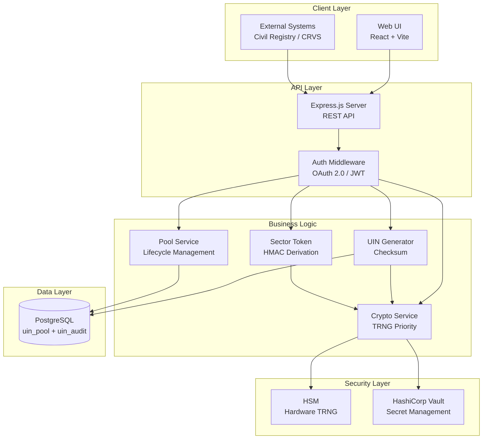
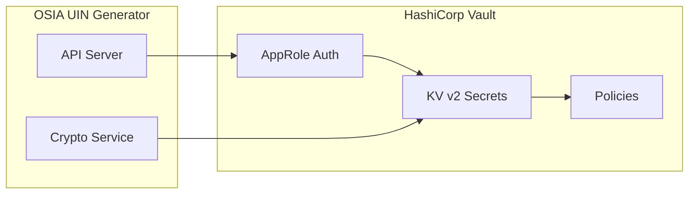
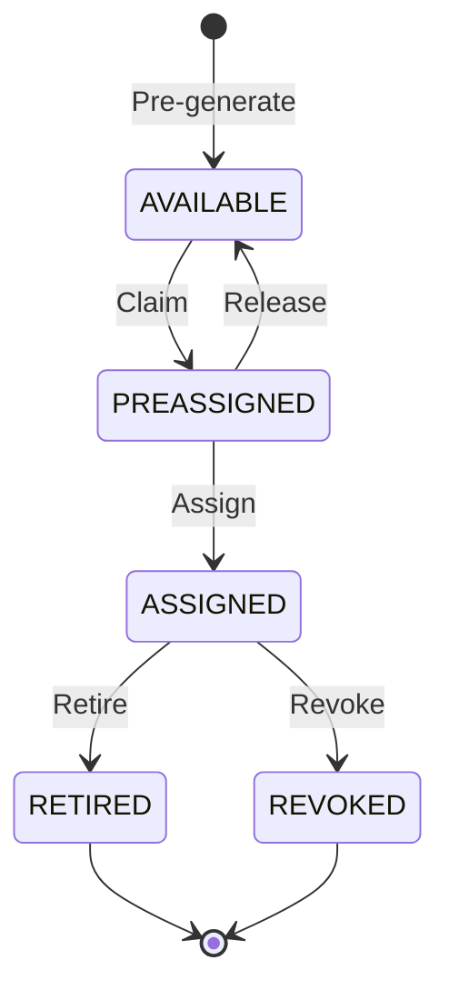
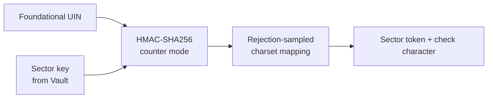
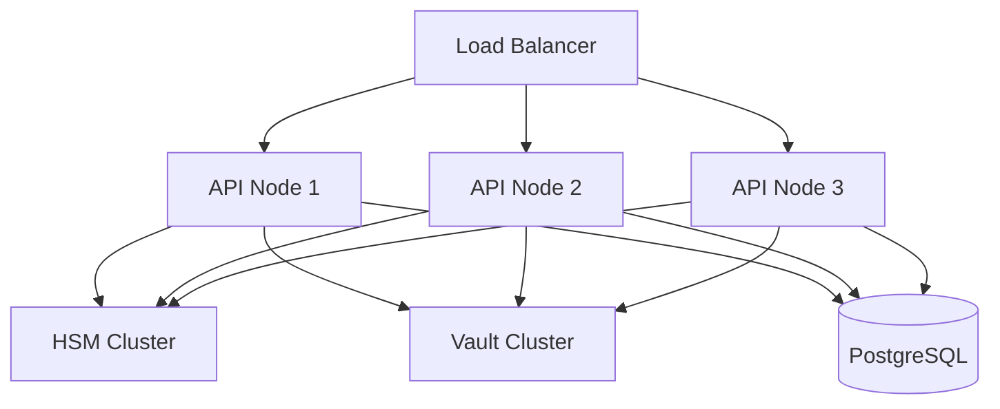

# OSIA UIN Generator v2.0

A production-grade, PostgreSQL-backed **Unique Identification Number (UIN)** generator based on the **[Open Standards for Identity APIs (OSIA)](https://osia.readthedocs.io/)** specification.

**Author:** Tunji Durodola <tunji.d@pocketone.eu>
**Organization:** [Secure Identity Alliance](https://secureidentityalliance.org)
**License:** MIT
**Online Tool:** [https://uin-generator.app](https://uin-generator.app)

---

## Principle: no PII

The OSIA UIN Generator deals exclusively in UINs, sector tokens, and opaque transaction correlators. It does **not** accept, store, log, derive from, or display Personally Identifiable Information — no names, dates of birth, document numbers, nationality, gender, biometrics, or MRZ personal fields. This is a hard invariant, not a preference; the tool's OSIA positioning depends on it. PII-accepting modes (MRZ / passport / TD1-TD3) were present in earlier versions and have been removed — MRZ generation belongs in downstream services that are authorised to handle PII.

## Principle: hardware-rooted randomness (fail-loud)

HSM integration is legitimacy-critical. The priority chain is Utimaco CryptoServer c3 (FIPS 140-2 Level 3) → YubiHSM 2 (FIPS 140-2 Level 2) → Node CSPRNG. Set `HSM_REQUIRE_HARDWARE=true` to refuse any request that cannot be served from hardware entropy; fallbacks are always logged loudly, never silent. `/crypto/status` surfaces the last-used source so reviewers can verify the chain is live.

---

## Table of Contents

- [Features](#features)
- [Architecture](#architecture)
- [Quick Start](#quick-start)
- [Hardware Security Module (HSM)](#hardware-security-module-hsm)
- [HashiCorp Vault Integration](#hashicorp-vault-integration)
- [API Reference](#api-reference)
- [UIN Lifecycle](#uin-lifecycle)
- [Generation Modes](#generation-modes)
- [Database Schema](#database-schema)
- [Security](#security)
- [Configuration](#configuration)
- [Terraform Infrastructure](#terraform-infrastructure)
- [Deployment](#deployment)
- [Web Interface](#web-interface)
- [Testing](#testing)
- [References](#references)
- [License](#license)

---

## Features

- **OSIA-Based Design** - Implements `POST /v1/uin` endpoint pattern (OSIA v1.2.0)
- **Four Generation Modes** - Foundational, Random, Structured, and Sector Token
- **PostgreSQL Pool Management** - Pre-generation, claiming, and assignment workflows
- **HSM Integration** - Hardware TRNG priority with PKCS#11 support
- **HashiCorp Vault** - Centralized secret management with AppRole authentication
- **Cryptographic Security** - Hardware TRNG, HMAC-SHA256, RIPEMD-160 hashing
- **Entropy Provenance Tracking** - Identify UIN entropy source (HSM TRNG vs software CSPRNG)
- **Complete Audit Trail** - Immutable logging of all UIN lifecycle events
- **Sector Tokenization** - Unlinkable, sector-specific derived identifiers
- **Multi-Format Output** - JSON, JWT (RFC 7519), and JSON-LD (W3C Linked Data)
- **Format Configuration** - Customizable display formats with separator and grouping options
- **React Web UI** - Professional interface with dark mode and multilingual support (EN, DE, FR, ES)
- **Pool Lifecycle Testing** - UI for fetch, pre-assign, assign, revoke, retire operations
- **Terraform IaC** - Multi-host deployment with GitHub Actions CI/CD

### Supported Sectors

| Sector | Description |
|--------|-------------|
| `health` | Healthcare / Medical services |
| `tax` | Tax / Revenue administration |
| `finance` | Financial services |
| `telco` | Telecommunications |
| `stats` | Statistics / Census |
| `education` | Education sector |
| `social` | Social services |
| `government` | Government / Public administration |

---

## Architecture

### High-Level System Overview



### Technology Stack

| Layer | Technology | Version |
|-------|------------|---------|
| Runtime | Node.js | 20+ |
| Server | Express.js | 4.x |
| Database | PostgreSQL | 17+ |
| Query Builder | Knex.js | 3.x |
| Frontend | React | 18.x |
| Build Tool | Vite | 5.x |
| Process Manager | PM2 | 6.x |
| Secret Management | HashiCorp Vault | 1.15+ |
| HSM Interface | PKCS#11 / graphene-pk11 | 2.x |
| IaC | Terraform | 1.5+ |

---

## Quick Start

### Prerequisites

- Node.js 20+
- PostgreSQL 15+ (17+ recommended)
- PM2 (optional, for production)
- HashiCorp Vault (optional, for secret management)
- HSM with PKCS#11 support (optional, for hardware TRNG)

### Installation

```bash
# Clone the repository
git clone https://github.com/tunjidurodola/osia_uin_generator.git
cd osia_uin_generator

# Install dependencies
npm install

# Install web UI dependencies
cd web && npm install && cd ..

# Configure environment (copy and edit)
cp .env.example .env

# Run database migrations (applies migrations/NNN_*.sql in order, tracked in schema_migrations)
npm run migrate

# Start the API server
npm start

# Or use PM2 for production
pm2 start ecosystem.config.cjs
```

### Verify Installation

```bash
# Health check (OSIA interface; OSIA_AUTH_MODE=optional for a local demo)
curl "http://localhost:19020/v1/health?transactionId=install-check"

# Check cryptographic services status
curl "http://localhost:19020/v1/crypto/status?transactionId=install-check"

# Generate a UIN (stateless)
curl -X POST "http://localhost:19020/v1/generate?transactionId=install-check" \
  -H "Content-Type: application/json" \
  -d '{"mode": "FOUNDATIONAL"}'
```

### Tests

```bash
npm test            # unit tests (legacy engine + OSIA v2 engine)
npm run test:db     # pool service integration tests (needs DB_*)
npm run test:api    # OSIA /v1 contract tests; every response is checked against api/uin.yaml
                    # (set OSIA_TEST_REQUIRE_DB=1 to fail instead of skipping DB-backed cases)
npm run lint:api    # Redocly lint of api/uin.yaml
```

---

## Hardware Security Module (HSM)

The OSIA UIN Generator supports Hardware Security Modules for cryptographic operations. **When an HSM with hardware TRNG is available, it is always prioritized over software-based random number generation.**

### Random Number Generation Priority

```
1. HSM Hardware TRNG (Thales, SafeNet, Utimaco, etc.)
   └── FIPS 140-2 Level 3 certified entropy source
2. Node.js CSPRNG (crypto.randomBytes)
   └── Software-based fallback
```

### Supported HSM Providers

| Provider | Type | TRNG | FIPS Level | Description |
|----------|------|------|------------|-------------|
| **Thales Luna** | Production | Yes | Level 3 | Enterprise network HSM |
| **SafeNet** | Production | Yes | Level 3 | ProtectServer, Luna legacy |
| **Utimaco** | Production | Yes | Level 3 | CryptoServer/SecurityServer |
| **nCipher/Entrust** | Production | Yes | Level 3 | nShield HSM |
| **AWS CloudHSM** | Cloud | Yes | Level 3 | AWS managed HSM |
| **Azure Dedicated HSM** | Cloud | Yes | Level 3 | Thales Luna-based |
| **YubiHSM 2** | Compact | Yes | Level 2 | USB HSM |
| **SoftHSM** | Development | No | - | Testing only |

### HSM Auto-Detection

The system automatically detects available HSMs in priority order:

```javascript
// Priority order (production HSMs first)
1. Thales Luna
2. SafeNet
3. Utimaco
4. nCipher/Entrust
5. AWS CloudHSM
6. Azure Dedicated HSM
7. YubiHSM
8. SoftHSM (development only)
```

### HSM Configuration

```bash
# Enable HSM
HSM_ENABLED=true

# Auto-detect HSM (recommended)
HSM_PROVIDER=auto

# Or specify provider explicitly
HSM_PROVIDER=thales|safenet|utimaco|ncipher|aws-cloudhsm|yubihsm|softhsm

# Custom library path (optional)
HSM_LIBRARY=/opt/safenet/lunaclient/lib/libCryptoki2_64.so

# HSM slot and authentication
HSM_SLOT=0
HSM_PIN=your-hsm-pin

# Key label for sector token derivation
HSM_KEY_LABEL=osia-sector-key
```

### HSM Status API

```bash
GET /crypto/status

# Response
{
  "hsm": {
    "enabled": true,
    "provider": "thales",
    "providerName": "Thales Luna",
    "providerType": "production",
    "hasTrng": true,
    "fipsLevel": 3,
    "mode": "hardware",
    "randomSource": "Thales Luna Hardware TRNG"
  }
}
```

---

## HashiCorp Vault Integration

HashiCorp Vault provides centralized secret management for sector secrets, database credentials, and HSM configuration.

### Vault Architecture



### Vault Configuration

```bash
# Enable Vault
VAULT_ENABLED=true

# Vault server address
VAULT_ADDR=http://127.0.0.1:8200

# Token authentication (development)
VAULT_TOKEN=your-root-token

# AppRole authentication (production - recommended)
VAULT_ROLE_ID=your-role-id
VAULT_SECRET_ID=your-secret-id

# Optional namespace (Vault Enterprise)
VAULT_NAMESPACE=admin
```

### Secrets Structure

```
osia/
├── sector-secrets     # HMAC secrets per sector
│   ├── health
│   ├── tax
│   ├── finance
│   └── ...
├── database           # PostgreSQL credentials
│   ├── host
│   ├── port
│   ├── username
│   └── password
└── hsm                # HSM configuration
    ├── provider
    ├── library
    ├── slot
    └── pin
```

### Vault Status API

```bash
GET /crypto/status

# Response includes
{
  "vault": {
    "enabled": true,
    "authenticated": true,
    "address": "http://127.0.0.1:8200"
  },
  "secretsLoaded": 8
}
```

---

## API Reference

### OSIA UIN Interface 2.0.0 (`/v1`)

The OpenAPI specification is [`api/uin.yaml`](api/uin.yaml). The server validates every
`/v1` request against that file (parameters and bodies, `additionalProperties: false`),
so the specification and the implementation cannot drift apart. Behind the public
reverse proxy the base URL is `https://uin-generator.app/api`.

Every operation:

- requires the `transactionId` query parameter (1-128 characters, no control characters);
  it is recorded in the audit trail of every pool operation;
- requires a bearer JWT carrying the operation's scope (see [Authentication](#authentication));
- returns errors as `{ "code": <http status>, "message": "..." }` and nothing else.

| Method | Endpoint | Scope | Success | Description |
|--------|----------|-------|---------|-------------|
| `GET` | `/v1/health` | `uin.metadata` | 200 | Service, HSM and Vault health |
| `GET` | `/v1/crypto/status` | `uin.metadata` | 200 | Entropy source (HSM TRNG or CSPRNG), FIPS level, Vault state |
| `GET` | `/v1/modes` | `uin.metadata` | 200 | `FOUNDATIONAL`, `RANDOM`, `STRUCTURED`, `SECTOR` |
| `GET` | `/v1/sectors` | `uin.metadata` | 200 | Sectors available for token derivation |
| `POST` | `/v1/uin` | `uin.generate` | 200 | OSIA 1.2 `generateUIN`; returns the UIN as a JSON string |
| `POST` | `/v1/generate` | `uin.generate` | 200 | Stateless generation (all modes, charsets, checksums, formatting, lifecycle claims, JSON/JWT/JSON-LD) |
| `POST` | `/v1/batch` | `uin.generate` | 200 | 1-1000 identifiers in one call |
| `POST` | `/v1/validate` | `uin.use` | 200 | Syntax, length, charset, checksum and optional registry status |
| `GET` | `/v1/uin/{uin}` | `uin.use` | 200 | Pool record (status, display format, entropy provenance) |
| `GET` | `/v1/uin/{uin}/audit` | `uin.use` | 200 | Append-only lifecycle audit trail |
| `GET` | `/v1/pool/stats` | `uin.pool` | 200 | Counts by status, optional `scope` |
| `GET` | `/v1/pool/peek` | `uin.pool` | 200 | Read-only preview (`status`, `scope`, `limit` 1-100) |
| `POST` | `/v1/uin/pre-generate` | `uin.pool` | 200 | Pre-generate up to 10 000 UINs into the pool |
| `POST` | `/v1/uin/claim` | `uin.pool` | 200 | AVAILABLE → PREASSIGNED (row-locked, optional `ttlSeconds`) |
| `POST` | `/v1/uin/assign` | `uin.pool` | 200 | PREASSIGNED → ASSIGNED (`entityId` is a non-personal surrogate key) |
| `POST` | `/v1/uin/release` | `uin.pool` | 200 | PREASSIGNED → AVAILABLE |
| `POST` | `/v1/uin/status` | `uin.pool` | 200 | ASSIGNED → RETIRED or REVOKED |
| `POST` | `/v1/uin/cleanup-preassigned` | `uin.pool` | 200 | Release reservations whose TTL (or `olderThanSeconds`) has elapsed |
| `GET` | `/v1/formats` | `uin.metadata` | 200 | Display format configurations |
| `POST` | `/v1/formats` | `uin.formats` | 201 | Create a format |
| `GET` | `/v1/formats/{code}` | `uin.metadata` | 200 | Read a format |
| `PUT` | `/v1/formats/{code}` | `uin.formats` | 200 | Update a format |
| `DELETE` | `/v1/formats/{code}` | `uin.formats` | 204 | Delete a format (not the default, not one in use) |

Generation operations return `503` when `HSM_REQUIRE_HARDWARE=true` and no hardware TRNG
is reachable. An invalid UIN submitted to `/v1/validate` is a normal `200` result with
`"valid": false`; `400` is reserved for malformed requests.

#### Examples

```bash
BASE=https://uin-generator.app/api
TXN=$(uuidgen)

# FOUNDATIONAL UIN with display formatting and a signed JWT representation
curl -s -X POST "$BASE/v1/generate?transactionId=$TXN" \
  -H "Authorization: Bearer $TOKEN" -H "Content-Type: application/json" \
  -d '{"mode":"FOUNDATIONAL","excludeAmbiguous":true,
       "formatting":{"enabled":true,"separator":"-","groupSize":4},
       "outputFormat":"JWT"}'

# Deterministic, unlinkable health-sector token (the base UIN is never logged or returned)
curl -s -X POST "$BASE/v1/generate?transactionId=$TXN" \
  -H "Authorization: Bearer $TOKEN" -H "Content-Type: application/json" \
  -d '{"mode":"SECTOR","sector":"health","baseUIN":"K7M2QX9P4RTA8WZC3HN"}'

# Pool lifecycle
curl -s -X POST "$BASE/v1/uin/claim?transactionId=$TXN" -H "Authorization: Bearer $TOKEN" \
  -H "Content-Type: application/json" -d '{"scope":"foundational","claimedBy":"civil-registry","ttlSeconds":900}'
curl -s -X POST "$BASE/v1/uin/assign?transactionId=$TXN" -H "Authorization: Bearer $TOKEN" \
  -H "Content-Type: application/json" -d '{"uin":"<uin>","entityId":"PERSON-12345"}'
curl -s -X POST "$BASE/v1/uin/status?transactionId=$TXN" -H "Authorization: Bearer $TOKEN" \
  -H "Content-Type: application/json" -d '{"uin":"<uin>","status":"RETIRED","reason":"Death registration"}'
curl -s "$BASE/v1/uin/<uin>/audit?transactionId=$TXN" -H "Authorization: Bearer $TOKEN"
```

### Authentication

`/v1` uses OSIA `BearerAuth` (JWT). Scopes are read from the `scope` claim
(space-delimited) or `scp` (array or string).

| Variable | Description |
|----------|-------------|
| `OSIA_AUTH_MODE` | `required` (default): every call needs a valid token with the operation's scope. `optional`: public-demo mode; calls without a token are accepted, a presented token is still fully verified and its scopes enforced |
| `OSIA_JWT_JWKS_URL` | Remote JWKS of the identity provider (RS256, PS256, ES256, ES384, EdDSA) |
| `OSIA_JWT_PUBLIC_KEY` | Alternatively, a single SPKI PEM public key |
| `OSIA_JWT_SECRET` | Alternatively, an HS256 shared secret (at least 32 bytes) |
| `OSIA_JWT_ISSUER` / `OSIA_JWT_AUDIENCE` | Required `iss` / `aud` values |

Failures return `401` (missing or invalid token) or `403` (missing scope) with an
RFC 6750 `WWW-Authenticate` challenge.

### Output representations

| `outputFormat` | Result |
|----------------|--------|
| `JSON` (default) | Plain `GenerateResponse` |
| `JWT` | Adds `jwt`: claims `iss`, `sub` (= UIN), `aud`, `iat`, `nbf`, `exp`, `jti`, `uin`, `mode`, `sector`, `txn`; signed with `OSIA_SIGNING_KEY` (PKCS#8 PEM, P-256 → ES256 or Ed25519 → EdDSA). The public key is carried in the `jwk` header. Without a configured key an ephemeral ES256 key is used for the life of the process |
| `JSON_LD` | Adds `jsonLd`: a W3C Verifiable Credentials Data Model 2.0 document (unsecured) |

### Legacy endpoints

The original routes are kept for the web UI and existing integrations. They are not part
of the OSIA interface and do not use the OSIA error envelope.

| Method | Endpoint | Description |
|--------|----------|-------------|
| `GET` | `/`, `/health`, `/crypto/status`, `/modes`, `/sectors` | Service information |
| `POST` | `/generate`, `/validate`, `/batch` | Stateless generation and validation (lower-case mode names, `checksum: { enabled, algorithm }`) |
| `POST` | `/hash/uin`, `/hash/uin/verify` | RIPEMD-160(SHA3-256(UIN + salt)) |
| `GET` | `/pool/stats`, `/pool/peek` | Pool statistics and preview |
| `POST` | `/pool/preassign`, `/pool/assign`, `/pool/revoke`, `/pool/retire` | Pool transitions |
| `POST` | `/uin/pre-generate` | Pre-generation |
| `GET` | `/uin/:uin`, `/uin/:uin/audit` | Raw pool record and audit rows |
| `GET` `POST` `PUT` `DELETE` | `/formats`, `/formats/:id`, `/formats/preview` | Format administration |

---

## UIN Lifecycle

### State Machine



### Lifecycle States

| Status | Description | Valid Transitions |
|--------|-------------|-------------------|
| `AVAILABLE` | Pre-generated, ready to be claimed | → PREASSIGNED |
| `PREASSIGNED` | Claimed, not yet bound to PII | → ASSIGNED, → AVAILABLE |
| `ASSIGNED` | Bound to a person/entity | → RETIRED, → REVOKED |
| `RETIRED` | No longer active (death) | Terminal |
| `REVOKED` | Invalidated (fraud) | Terminal |

---

## Generation Modes

### 1. FOUNDATIONAL (default)

High-entropy, lifelong identifier with no embedded personal data. Characters are drawn by
rejection sampling (no modulo bias) from bytes supplied by the HSM priority chain.

```json
{
  "mode": "FOUNDATIONAL",
  "length": 19,
  "charset": "ALPHANUMERIC",
  "excludeAmbiguous": true,
  "checksum": "ISO7064_MOD37_2"
}
```

`length` is the canonical length including check characters. Charsets: `ALPHANUMERIC`,
`NUMERIC`, `ALPHABETIC`, `HEXADECIMAL`. Checksums: `NONE`, `ISO7064` / `ISO7064_MOD37_2`,
`ISO7064_MOD97_10`, `LUHN`, `DAMM` (Luhn and Damm require `NUMERIC`).

### 2. RANDOM

Same engine and parameters as FOUNDATIONAL, for identifiers that are not lifelong.

### 3. STRUCTURED

A pattern of literals and named groups. `random…` groups are filled with random characters,
a `checksum` group receives the check character(s) computed over the preceding groups, and
any other group embeds the attribute of the same name. Only non-personal administrative
attributes may be embedded (default allow-list: `regionCode`, `districtCode`, `officeCode`,
`issuerCode`, `registryCode`, `sectorCode`, `countryCode`, `registrationYear`, `batchCode`;
override with `UIN_STRUCTURED_ATTRIBUTES`). Patterns are evaluated in an isolated context
with a time limit.

```json
{
  "mode": "STRUCTURED",
  "pattern": "(?<regionCode>[A-Z]{2})-(?<registrationYear>[0-9]{4})-(?<random>[0-9]{6})-(?<checksum>[0-9]{1})",
  "attributes": { "regionCode": "NW", "registrationYear": "2026" }
}
```

### 4. SECTOR

Deterministic, unlinkable sector-specific tokens: the same base UIN and sector always give
the same token, different sectors give unrelated tokens, and the base UIN cannot be
recovered without the sector key.



---

## Security

### Cryptographic Components

| Component | Source | Purpose |
|-----------|--------|---------|
| Random Generation | HSM TRNG (priority) / Node.js CSPRNG | UIN generation |
| Integrity Hash | RIPEMD-160(SHA3-256(UIN+salt)) | UIN verification |
| Sector Derivation | HMAC-SHA256 via HSM | Unlinkable tokens |
| Secret Storage | HashiCorp Vault | Secure secrets |
| Key Protection | HSM (non-extractable) | HMAC keys |

### Security Best Practices

1. **Hardware TRNG Priority** - HSM TRNG is always preferred over CPU-based PRNG
2. **Vault for Secrets** - All sector secrets stored in HashiCorp Vault
3. **HSM Key Protection** - HMAC keys are non-extractable from HSM
4. **No PII in UIN** - Foundational mode embeds no personal data
5. **FIPS Compliance** - Production HSMs are FIPS 140-2 Level 3 certified
6. **Audit Immutability** - Audit records are append-only

---

## Configuration

### Environment Variables

```bash
# Server Configuration
PORT=19020
HOST=0.0.0.0
NODE_ENV=production

# Database (PostgreSQL)
DB_HOST=localhost
DB_PORT=5432
DB_USER=osia_user
DB_PASSWORD=secure_password
DB_NAME=osia_prod
PGSSLMODE=require            # managed PostgreSQL; NODE_EXTRA_CA_CERTS verifies the chain

# OSIA interface (see API Reference > Authentication)
OSIA_AUTH_MODE=required
OSIA_JWT_JWKS_URL=https://idp.example.gov/.well-known/jwks.json
OSIA_JWT_ISSUER=https://idp.example.gov
OSIA_ISSUER=https://registry.example.gov   # default iss of JWT / JSON-LD outputs
OSIA_SIGNING_KEY=<PKCS#8 PEM>              # signs JWT outputs
HSM_REQUIRE_HARDWARE=true                  # refuse to issue from software entropy

# Rate limiting (requests per minute per client)
UIN_RATE_LIMIT_MAX=100
UIN_GENERATE_RATE_LIMIT_MAX=30
UIN_TRUST_PROXY=loopback                   # client address from X-Forwarded-For set by the local proxy

# HashiCorp Vault
VAULT_ENABLED=true
VAULT_ADDR=http://127.0.0.1:8200
VAULT_ROLE_ID=<role-id>
VAULT_SECRET_ID=<secret-id>

# HSM Configuration
HSM_ENABLED=true
HSM_PROVIDER=auto
HSM_SLOT=0
HSM_PIN=<hsm-pin>
HSM_KEY_LABEL=osia-sector-key

# Sector Secrets (if not using Vault)
SECTOR_SECRET_HEALTH=<32+ byte secret>
SECTOR_SECRET_TAX=<32+ byte secret>
# ... etc
```

---

## Terraform Infrastructure

### Multi-Host Deployment

The Terraform configuration supports deployment to multiple hosts:

| Host | IP Address | Role |
|------|------------|------|
| localhost | 127.0.0.1 | Development |
| node1 | 192.168.0.5 | API Server |
| node2 | 192.168.0.16 | API Server |
| node3 | 192.168.0.18 | API Server |

### Quick Start

```bash
cd terraform
cp terraform.tfvars.example terraform.tfvars
# Edit terraform.tfvars with your values

terraform init
terraform plan
terraform apply
```

### GitHub Actions CI/CD

The repository includes GitHub Actions workflows:

- **terraform.yml** - Terraform plan/apply/destroy with environment gates
- **codeql.yml** - CodeQL security analysis and npm audit

---

## Deployment

### PM2 Deployment

```bash
pm2 start ecosystem.config.cjs
pm2 logs osia-uin-api-dev
pm2 monit
```

### Production Architecture



---

## Web Interface

The React-based web interface provides a professional, full-width design with:

### Features

- **Generate UIN** - Mode selection, parameters, JWT/JSON-LD output formats
- **Pool Management** - Statistics, pre-generation with format selection, monitoring
- **UIN Lookup** - Search, details, audit trail with formatted display
- **Security** - HSM/Vault status, provider information, cryptographic services
- **Documentation** - API reference, Mermaid architecture diagrams

### Multilingual Support

The UI supports four languages with a header dropdown selector:

| Language | Code | Flag |
|----------|------|------|
| English | EN | US |
| German | DE | DE |
| French | FR | FR |
| Spanish | ES | ES |

### Dark Mode

Full dark mode support with:
- Theme toggle in header
- Optimized Mermaid diagram rendering
- Consistent color variables throughout

### Format Configuration

UIN display formats can be configured with:
- Separator characters (dash, space, dot, custom)
- Group sizes for digit grouping
- Prefix/suffix text
- Format association stored in database (not the formatted value)

```bash
cd web
npm install
npm run build  # Production build
npm run dev    # Development server
```

---

## Testing

### Unit Tests

```bash
npm test
```

### Integration and Contract Tests

```bash
npm run test:db     # pool service against PostgreSQL
npm run test:api    # OSIA /v1 contract tests (responses validated against api/uin.yaml)
npm run lint:api    # Redocly lint of the specification
```

### Health Check

```bash
curl "http://localhost:19020/v1/health?transactionId=health-check"

# Response includes HSM/Vault status
{
  "status": "healthy",
  "version": "2.0.0",
  "crypto": {
    "hsm": { "enabled": true, "hasTrng": true },
    "vault": { "enabled": true, "authenticated": true }
  }
}
```

---

## Contributing

We welcome contributions from the community! Please read our [Code of Conduct](CODE_OF_CONDUCT.md) before contributing.

### Guidelines

- Follow OSIA v1.2.0 specification standards
- Adhere to security best practices (OWASP Top 10, secure coding)
- Never commit actual UINs, PII, or sensitive data
- Include tests for new features
- Update documentation for API changes
- Use meaningful commit messages

### Security Vulnerabilities

If you discover a security vulnerability, please report it privately to the project maintainers. Do not open a public issue.

### Development

```bash
# Clone the repository
git clone https://github.com/tunjidurodola/osia_uin_generator.git
cd osia_uin_generator

# Install dependencies
npm install
cd web && npm install

# Run tests
npm test

# Start development servers
npm run dev
```

See [CODE_OF_CONDUCT.md](CODE_OF_CONDUCT.md) for detailed compliance and contribution standards.

---

## References

- [OSIA Specification](https://osia.readthedocs.io/en/stable/)
- [Secure Identity Alliance](https://secureidentityalliance.org)
- [PKCS#11 Specification](http://docs.oasis-open.org/pkcs11/pkcs11-base/v2.40/pkcs11-base-v2.40.html)
- [HashiCorp Vault Documentation](https://www.vaultproject.io/docs)
- [FIPS 140-2 Validation](https://csrc.nist.gov/projects/cryptographic-module-validation-program)
- [RFC 7519 - JSON Web Token (JWT)](https://tools.ietf.org/html/rfc7519)

---

## License

MIT License

Copyright (c) 2025 Tunji Durodola, Secure Identity Alliance

Permission is hereby granted, free of charge, to any person obtaining a copy of this software and associated documentation files (the "Software"), to deal in the Software without restriction, including without limitation the rights to use, copy, modify, merge, publish, distribute, sublicense, and/or sell copies of the Software, and to permit persons to whom the Software is furnished to do so, subject to the following conditions:

The above copyright notice and this permission notice shall be included in all copies or substantial portions of the Software.

THE SOFTWARE IS PROVIDED "AS IS", WITHOUT WARRANTY OF ANY KIND, EXPRESS OR IMPLIED, INCLUDING BUT NOT LIMITED TO THE WARRANTIES OF MERCHANTABILITY, FITNESS FOR A PARTICULAR PURPOSE AND NONINFRINGEMENT. IN NO EVENT SHALL THE AUTHORS OR COPYRIGHT HOLDERS BE LIABLE FOR ANY CLAIM, DAMAGES OR OTHER LIABILITY, WHETHER IN AN ACTION OF CONTRACT, TORT OR OTHERWISE, ARISING FROM, OUT OF OR IN CONNECTION WITH THE SOFTWARE OR THE USE OR OTHER DEALINGS IN THE SOFTWARE.
